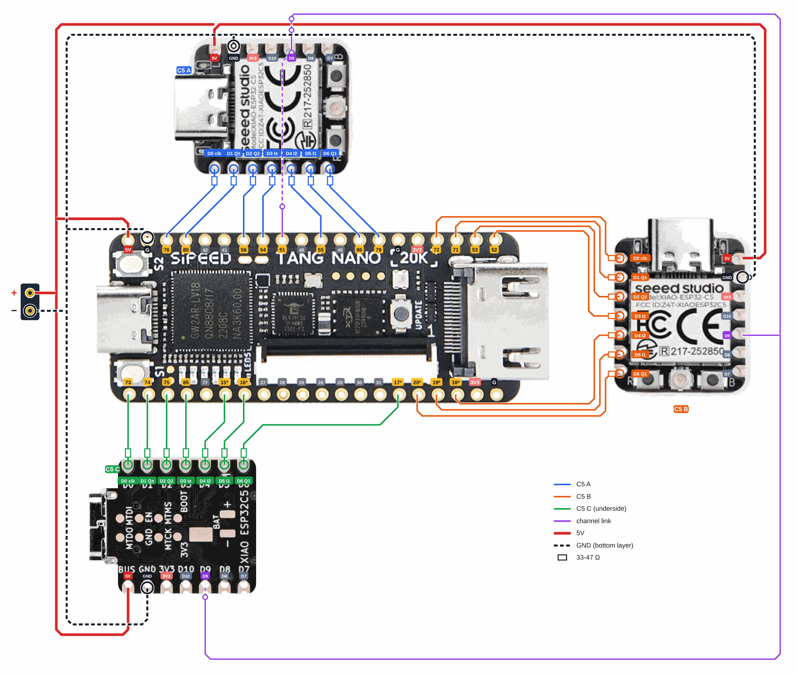

# C5VRX Triversity

Three XIAO ESP32-C5 receivers, one Sipeed Tang Nano 20K, true IQ fusion.

Each C5 receives the same 5.8 GHz analog FPV channel on its own antenna and
streams raw IQ (3-bit I + 3-bit Q, 40 MS/s) plus its sample clock to the FPGA.
The FPGA aligns the three streams, combines them **before** FM demodulation
(maximal-ratio combining with a phase tracker per branch), demodulates once
and drives an 800x480 RGB LCD.

- **Triversity**: three C5s combined.
- **DVR mode**: two C5s combined, the third branch is released for recording.
- Gain, DC and AFC stay local on each C5; the FPGA only tells them which
  channel to use (one shared UART wire).
- All three C5s run the same firmware; the wiring decides which is A, B or C.
- Three buttons on C5 A (Select, Up, Down) open the FPGA's on-screen menu.

> Status: C5 firmware builds and passes its host tests; FPGA design and host
> simulation. Nothing has run on a board yet.

## Why IQ fusion

AV diversity (switching or mixing demodulated video) helps against fades but
cannot move the FM threshold: if every receiver is below it, the mix is noise.
IQ fusion adds the signals first, so one demodulator sees a better signal.

Host simulation against one C5VRX receiver (production D32-R2 decoder), same
channel model (NTSC, independent noise, Rayleigh fading per antenna):

| C/N gain vs one C5VRX | static | fading 100 Hz | fading 300 Hz |
|---|---|---|---|
| 3 C5s, picture lock 50 % | +3.2 dB | +3.8 dB | +3.6 dB |
| 3 C5s, picture lock 90 % | +3.9 dB | +8.3 dB | +5.7 dB |
| 2 C5s (DVR), lock 50 % | +1.6 dB | +2.5 dB | +2.5 dB |
| 2 C5s (DVR), lock 90 % | +2.1 dB | +4.4 dB | +2.0 dB |

Picture noise at equal C/N is 5-6 dB lower with three C5s. Requires the
click-suppressed discriminator (D32-R2's 50 ns rule on the combined angle);
the plain per-sample discriminator loses 3-5 dB. Simulation only: no board,
goggle or range result.

## Wiring

| XIAO pad | signal | C5 A | C5 B | C5 C |
|---|---|---|---|---|
| D0 | clock (RX40) | 76 | 72 | 73 |
| D1 | Q sign | 80 | 71 | 74 |
| D2 | Q bit 2 | 56 | 53 | 75 |
| D3 | I sign | 54 | 52 | 85 |
| D4 | I bit 2 | 55 | 18 | 15 |
| D5 | I bit 1 | 86 | 19 | 16 |
| D6 | Q bit 1 | 79 | 20 | 17 |
| D10 | channel link (UART RX) | 51 | 51 | 51 |
| MTDO, MTCK (back) | Q0, I0, internal only, not connected | - | - | - |

Buttons, C5 A only, on its free side pads (each to GND, internal pull-up):

| pad | GPIO | button |
|---|---|---|
| D9 | 9 | Up |
| D8 | 8 | Select |
| D7 | 12 | Down |

The XIAO's own B (BOOT) button still flashes as usual and can act as Select.
C5 A forwards a press in-band in its IQ stream; the FPGA drops C5 A from the
combination for those few microseconds (B and C cover it) and handles the menu.

Numbers are Tang Nano 20K pins; the 40-pin LCD keeps its own pins.

- C5 C sits on the underside of the carrier, so its row runs D0..D6 like A and B.
- Pin 51 is the onboard amplifier enable: the channel link is sent inverted
  (idle low), which keeps the amplifier off.
- 5V and GND: one input (+ / -), GND from the Tang pin next to 5V to every C5.
- 33-47 ohm series resistor on every IQ line, close to the XIAO.
- Avoid GPIO11 (D6) for timing-critical bits; only Q bit 1 uses it.

## C5 firmware

`firmware/` is a stripped C5VRX-5 receiver for this job: the same image runs on
all three C5s (ESP-IDF v6.0.2, `idf.py set-target esp32c5 build`; CI builds it
and runs the host tests in `firmware/test/run_tests.sh`).

Kept from C5VRX, unchanged in behaviour: RF front end and PHY baseline (11p
helper, digital filter mode 12), Direct Gain with LEVEL AGC, LEVEL TOP and
STRONG LANE, C/N-AUTO noise maps, DC tables, base map and live DC servo, LOW
DC, sampling-phase alignment at boot, manual filter/DC calibration (F, B),
AFC with PAL/NTSC detection, VTX profiles, flight log and field diagnostics.

Removed: the BitScrambler decoders and their tables, PARLIO TX and the DAC,
output level and AUTO OUTPUT, the on-screen menu, splash and BOOT-button UI,
the channel scanner and the bench labs. The FPGA demodulates, draws the menu
and scans.

New:

- PARLIO RX clock exported on D0; IQ pads as in the wiring table.
- FPGA link on D10 (`firmware/main/fpga_link.h`): channel, gain model, AFC and
  calibration requests from the FPGA's menu.
- In-band markers on the IQ pads: button presses and once a second the gain
  row, C/N, flags (AFC lock, video, busy, DC fault, lane, PAL), channel and
  signal strength, for the FPGA's OSD.

- IQ LED: the Q sign bit is also copied onto the XIAO's own user LED. Half lit =
  IQ flowing; fully on or off = IQ stopped. Console `L` turns it off (80 MHz
  edges next to the antenna: switch it off for a noise comparison).

USB console: `T` status, `h` keys, `L` IQ LED, `` ` `` reboot to download.

## Open questions for the first prototype

1. IQ pad timing at the FPGA (the modem bus runs at ~80 MS/s, sampled at 40).
2. Frequency offset between the three C5s before AFC lock.
3. Self-noise: C5 noise floor with the FPGA and LCD on and off.
4. C5 boot with the FPGA powered (D2/D3 are strapping pins).

## Credits

This project adapts the Triversity combiner (called Tripleversity there), its models and the receiver
research from [C5VRX](https://github.com/Twotoz/C5VRX) by Twotoz and the
C5VRX contributors (`hardware_experiments/tang9k_dual` and
`hardware_experiments/tripleversity` on the `claude/tang-9k-c5-5bit-iq-hmes6d`
branch, and the D32-R2 decoder). The C5 firmware in `firmware/` is adapted from
C5VRX-5 `main/`, `CMakeLists.txt`, `sdkconfig.defaults` and `partitions.csv`
at commit `f3d172f` (C5VRX main `8b60fef` plus that branch), and its host tests
from C5VRX `test/`; the changes are listed under "C5 firmware" above and in
each changed file's header. Visit the
[official C5VRX website](https://twotoz.github.io/C5VRX/) for the original
project and its Discord invite. C5VRX is GPL-3.0-only, and so is `firmware/` (`firmware/LICENSE`); this derivative is not
an official C5VRX release.

Board photos: Sipeed (Tang Nano 20K) and Seeed Studio (XIAO ESP32-C5).
