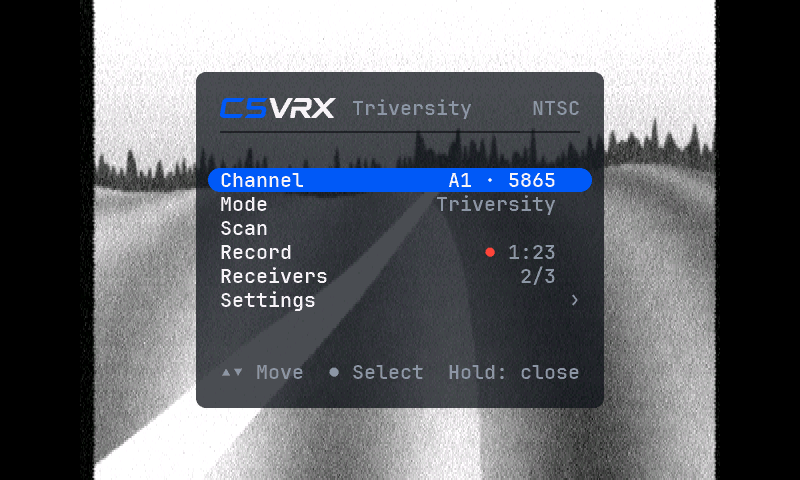
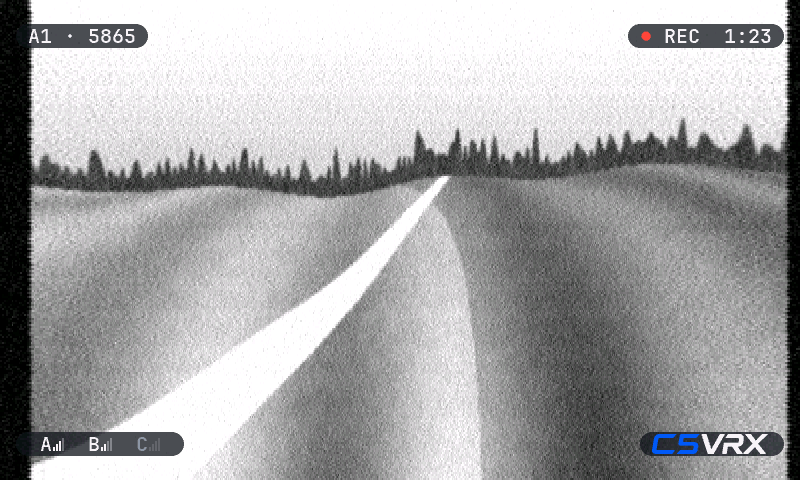
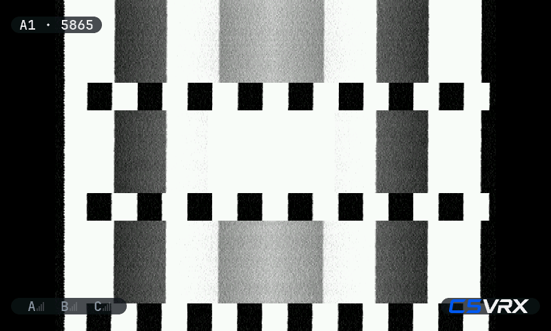

<div align="center">
  

  <p><strong>Three ESP32-C5 receivers, one FPGA, true diversity with IQ fusion</strong></p>
  <p>Three Seeed Studio XIAO ESP32-C5 receive the same 5.8 GHz FPV channel on their own antennas; a Sipeed Tang Nano 20K fuses their IQ before demodulation and drives an 800x480 screen with a menu and a DVR.</p>

  <p>
    <a href="https://twotoz.github.io/C5VRX/"></a>
    <a href="https://discord.gg/3YNgJRHmzD"></a>
    
    
    
    
    
  </p>

  <p>
    
    
  </p>
</div>

---

Each C5 streams raw IQ (3-bit I + 3-bit Q, 40 MS/s) plus its sample clock to
the FPGA. The FPGA aligns the three streams, combines them **before** FM
demodulation (maximal-ratio combining with a phase tracker per branch),
demodulates once and shows the picture with an on-screen menu.

- Three receivers, three antennas, one picture: a fading antenna counts less,
  a dead one drops out, and together they push the FM threshold down.
- Mode Single, Diversity (two C5s fused) or Triversity (three fused).
- Gain, DC and AFC stay local on each C5; the FPGA sets the channel and the
  settings over one shared wire.
- All three C5s run the same firmware; the wiring decides which is A, B or C.
- Three buttons on C5 A (Up, Select, Down) drive the menu.
- DVR to the Tang's TF card.

> [!NOTE]
> **Triversity is an official C5VRX version**, made by Twotoz and the C5VRX
> contributors as part of the C5VRX project.

> [!NOTE]
> **Status:** C5 firmware and FPGA bitstream build; models, RTL, the video
> path and the OSD are verified in simulation. Nothing has run on a board yet.

## Experimental hardware — flight safety warning

> [!WARNING]
> **Triversity is an experimental FPV receiver that has not flown yet. Bugs,
> signal loss or incompatibility with your VTX can cause sudden loss of video.
> Loss of FPV video can lead to a crash, property damage or serious injury.**
> Do not rely on it as your only means of keeping safe control of an aircraft.

- Test every firmware, bitstream and settings combination on the ground
  first, propellers removed.
- Scanning, channel changes, calibration and mode changes can interrupt the
  picture: do them on the ground.
- Provided under [GPL-3.0-only](LICENSE), including its warranty and
  liability provisions in sections 15–17.

## Menu

Rendered by the FPGA RTL in simulation (`fpga/sim/run_osd_tb.py`), pixel for
pixel what the LCD shows. The picture behind it went through the receive chain
too (three C5s at 13 dB C/N, IQ fusion, discriminator, sync): the grain is the
receiver's own.

| | |
|---|---|
|  |  |
|  |  |

| | live view | menu | editing a value |
|---|---|---|---|
| Up / Down | channel | move | change (live) |
| Select | open menu | open / toggle / edit | done |
| Hold Select | | close | close |

- **Channel**: all 48 (R, A, B, E, F, L); the pill lights up after a change.
- **Mode**: how many C5s are fused: Single (A), Diversity (A + B, IQ fusion)
  or Triversity (A + B + C, IQ fusion). C5s left out keep running and show
  Idle; the live view greys them out.
- **Scan**: every channel 0.5 s, picks the one with the best sync.
- **Record**: DVR on / off; No card, Ready, the recording time, Card err.
- **Receivers**: per C5 signal, C/N, gain row and AFC state.
- **Settings**: gain model (Level, Keel, RSSI), AFC, aspect, logo,
  brightness, calibrate (filter and DC on every C5).
- **Aspect**: 4:3 (the picture in the middle 640 columns, black bars), 16:9
  (full width, for 16:9 cameras), Stretch (a 4:3 picture over the full width:
  true geometry in the middle, the edges stretched), Auto (16:9 when the camera
  says so with CGMS-A on NTSC or WSS on PAL, else 4:3; detection checked in
  simulation, not yet with a real FPV camera).
- **Logo**: the small C5VRX logo in the live view, on or off.

The OSD is made for the 5" 800x480 screen: 12 x 24 pixel characters, a
monospace font that stays sharp at that size, no thin lines.

## Why IQ fusion

Classic true diversity switches between receivers after demodulation, and AV
mixing adds demodulated video: both help against fades but cannot move the FM
threshold, so if every receiver is below it, the result is noise. IQ fusion
adds the signals first, so one demodulator sees a better signal.

Host simulation against one C5VRX receiver (production D32-R2 decoder), same
channel model (NTSC, independent noise, Rayleigh fading per antenna):

| C/N gain vs one C5VRX | static | fading 100 Hz | fading 300 Hz |
|---|---|---|---|
| 3 C5s, picture lock 50 % | +3.2 dB | +3.8 dB | +3.6 dB |
| 3 C5s, picture lock 90 % | +3.9 dB | +8.3 dB | +5.7 dB |
| 2 C5s, lock 50 % | +1.6 dB | +2.5 dB | +2.5 dB |
| 2 C5s, lock 90 % | +2.1 dB | +4.4 dB | +2.0 dB |

Picture noise at equal C/N is 5-6 dB lower with three C5s. Requires the
click-suppressed discriminator (D32-R2's 50 ns rule on the combined angle);
the plain per-sample discriminator loses 3-5 dB. Simulation only: no board,
goggle or range result.

## Wiring


| XIAO pad | signal | C5 A | C5 B | C5 C |
|---|---|---|---|---|
| D0 | clock (RX40) | 76 | 72 | 73 |
| D1 | Q sign | 80 | 71 | 74 |
| D2 | Q bit 2 | 56 | 53 | 75 |
| D3 | I sign | 54 | 52 | 85 |
| D4 | I bit 2 | 55 | 18 | 15 |
| D5 | I bit 1 | 86 | 19 | 16 |
| D6 | Q bit 1 | 79 | 20 | 17 |
| D10 | channel link (UART RX) | 51 | 51 | 51 |
| MTDO, MTCK (back) | Q0, I0, internal only, not connected | - | - | - |

Buttons, C5 A only, on its free side pads (each to GND, internal pull-up):

| pad | GPIO | button |
|---|---|---|
| D9 | 9 | Up |
| D8 | 8 | Select |
| D7 | 12 | Down |

The XIAO's own B (BOOT) button still flashes as usual and can act as Select.
C5 A forwards a press in-band in its IQ stream; the FPGA drops C5 A from the
combination for those few microseconds (B and C cover it) and handles the menu.

Numbers are Tang Nano 20K pins; the 40-pin LCD keeps its own pins.

- C5 C sits on the underside of the carrier, so its row runs D0..D6 like A and B.
- Pin 51 is the onboard amplifier enable: the channel link is sent inverted
  (idle low), which keeps the amplifier off.
- 5V and GND: one input (+ / -), GND from the Tang pin next to 5V to every C5.
- 33-47 ohm series resistor on every IQ line, close to the XIAO.
- Avoid GPIO11 (D6) for timing-critical bits; only Q bit 1 uses it.

## Repository

```
c5/            C5 firmware (ESP-IDF), one image for C5 A, B and C
  main/        receiver, gain, calibration, AFC, FPGA link and markers
  test/        host tests
fpga/          FPGA design for the Tang Nano 20K
  rtl/rx/      capture alignment, markers, IQ fusion, discriminator
  rtl/video/   sync, line buffer, LCD output
  rtl/ui/      menu and OSD (glyphs and pages generated)
  rtl/io/      link to the C5s, DVR
  boards/      pin constraints
  gen/         generators: OSD look (gen_osd.py), combiner tables
  model/       Python models of the combiner
  sim/         testbenches and their runners
  build.sh     bitstream (open-source Gowin flow)
tools/         PC tools: DVR file and video
docs/          images
```

Two firmware chains, two CI workflows: `c5.yml` (host tests, ESP-IDF build)
and `fpga.yml` (all testbenches, bitstream).

## C5 firmware

`c5/` is a stripped C5VRX-5 receiver for this job: the same image runs on
all three C5s (ESP-IDF v6.0.2, `idf.py set-target esp32c5 build`; CI builds it
and runs the host tests in `c5/test/run_tests.sh`).

Kept from C5VRX, unchanged in behaviour: RF front end and PHY baseline (11p
helper, digital filter mode 12), Direct Gain with LEVEL AGC, LEVEL TOP and
STRONG LANE, C/N-AUTO noise maps, DC tables, base map and live DC servo, LOW
DC, sampling-phase alignment at boot, manual filter/DC calibration (F, B),
AFC with PAL/NTSC detection, VTX profiles, flight log and field diagnostics.

Removed: the BitScrambler decoders and their tables, PARLIO TX and the DAC,
output level and AUTO OUTPUT, the on-screen menu, splash and BOOT-button UI,
the channel scanner and the bench labs. The FPGA demodulates, draws the menu
and scans.

New:

- PARLIO RX clock exported on D0; IQ pads as in the wiring table.
- FPGA link on D10 (`c5/main/fpga_link.h`): channel, gain model, AFC and
  calibration requests from the FPGA's menu.
- In-band markers on the IQ pads: button presses and once a second the gain
  row, C/N, flags (AFC lock, video, busy, DC fault, lane, PAL), channel and
  signal strength, for the FPGA's OSD.

- IQ LED: the Q sign bit is also copied onto the XIAO's own user LED. Half lit =
  IQ flowing; fully on or off = IQ stopped. Console `L` turns it off (80 MHz
  edges next to the antenna: switch it off for a noise comparison).

USB console: `T` status, `h` keys, `L` IQ LED, `` ` `` reboot to download.

## FPGA

`fpga/build.sh` builds the bitstream (Yosys, nextpnr-himbaechel, Apicula);
`openFPGALoader -b tangnano20k -f fpga/build/triversity.fs` flashes it.

- IQ path on C5 A's 40 MHz clock: capture of the three C5s, alignment of B and
  C to A, marker detection (a C5 sending a marker is left out for those
  samples), pre-detection MRC and the click-suppressed 50 ns discriminator
  (`rtl/rx/mrc3_core.v`, bit-exact with `model/mrc3_model.py`).
- Video: sync slicer with H/V flywheel, PAL/NTSC detection, automatic black
  and white levels, 800-pixel lines into a line buffer. Monochrome for now; colour decoding (NTSC/PAL chroma) is next.
- LCD, menu and link on a 33.75 MHz PLL clock from the Tang's crystal: every
  video line shown twice (480 lines, genlocked, no frame buffer). OSD: 66 x 20
  cells of 12 x 24 pixels, anti-aliased glyphs, panels that dim the video.
- DVR (`rtl/io/dvr.v`): 400x240 in 16 grey levels at 30 fps (NTSC) or 25 fps
  (PAL): every second field, every second pixel of the line. To
  `TRIDVR.BIN` on the TF card (SPI mode, FAT32, written as a ring: the oldest
  part is overwritten). About 87 MB a minute; a slow card drops whole frames,
  never half ones.
- Fit: 79 % LUT4, 37 of 46 BSRAM (16 for the DVR buffer, 6 glyphs, 6 page
  templates, 3 aspect maps), 45 MULT9 + 4 MULT18; 59 MHz on the 40 MHz IQ
  clock, 78 MHz on the 33.75 MHz LCD clock, no hold violations.

DVR on the PC:

```
python tools/make_dvr_file.py /media/TF          # once, on a freshly formatted FAT32 card
python tools/dvr_to_mp4.py /media/TF/TRIDVR.BIN rec.mp4
```

The LCD and HDMI cannot run at the same time on the Tang Nano 20K: the HDMI
pairs (pins 33-40) are the LCD's green and red pins. The DVR uses its own
pins (the TF slot), so LCD + DVR and HDMI + DVR both fit. HDMI would be a
separate bitstream at 720x480p (NTSC) / 720x576p (PAL): exactly twice the
analog line rate, so the same genlocked line doubling without a frame buffer. The pins' IO standard is
fixed in a bitstream (LVCMOS for the LCD, LVDS for HDMI), so switching between
them in the menu means loading the other bitstream.

Simulation (`fpga/sim/`): `run_tb3.py` (combiner, bit-exact), `run_marker_tb.py`,
`run_link_tx_tb.py`, `run_dvr_tb.py` (SD card model with a FAT32 image, fast
and slow card), `run_osd_tb.py` (OSD pixel for pixel against `gen/gen_osd.py`),
`run_aspect_tb.py` (CGMS-A / WSS through the receive chain),
`run_video_tb.py` (test picture through the whole chain; needs C5VRX's
`research/` next to this repo or in `$C5VRX_RESEARCH`).



## Open questions for the first prototype

1. IQ pad timing at the FPGA (the modem bus runs at ~80 MS/s, sampled at 40).
2. Frequency offset between the three C5s before AFC lock.
3. Self-noise: C5 noise floor with the FPGA and LCD on and off.
4. C5 boot with the FPGA powered (D2/D3 are strapping pins).

## Credits

Triversity is part of [C5VRX](https://github.com/Twotoz/C5VRX) by Twotoz and
the C5VRX contributors. The combiner (Tripleversity in C5VRX), its models and
the receiver research come from C5VRX (`hardware_experiments/tang9k_dual`,
`hardware_experiments/tripleversity` and the D32-R2 decoder). The C5 firmware
in `c5/` is C5VRX-5 `main/`, `CMakeLists.txt`, `sdkconfig.defaults` and
`partitions.csv` at commit `f3d172f` (C5VRX main `8b60fef` plus the
`claude/tang-9k-c5-5bit-iq-hmes6d` branch), stripped for this job, with its
host tests from C5VRX `test/`; each changed file's header says what changed.
Visit the [C5VRX website](https://twotoz.github.io/C5VRX/) for the project and
its Discord invite. GPL-3.0-only (`LICENSE`).

OSD font: JetBrains Mono (SIL Open Font License 1.1). Board photos: Sipeed
(Tang Nano 20K) and Seeed Studio (XIAO ESP32-C5).
