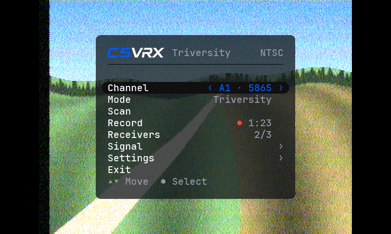
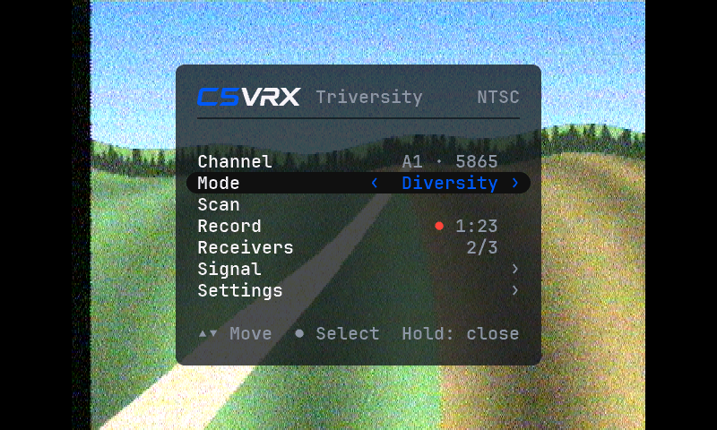
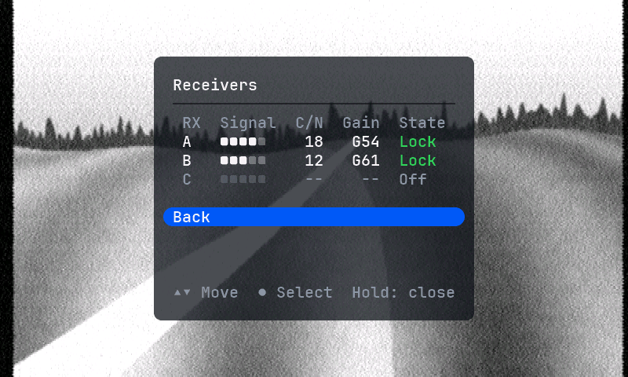
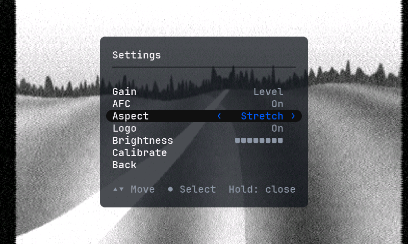
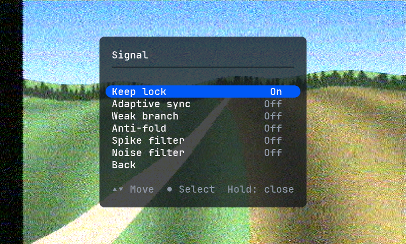
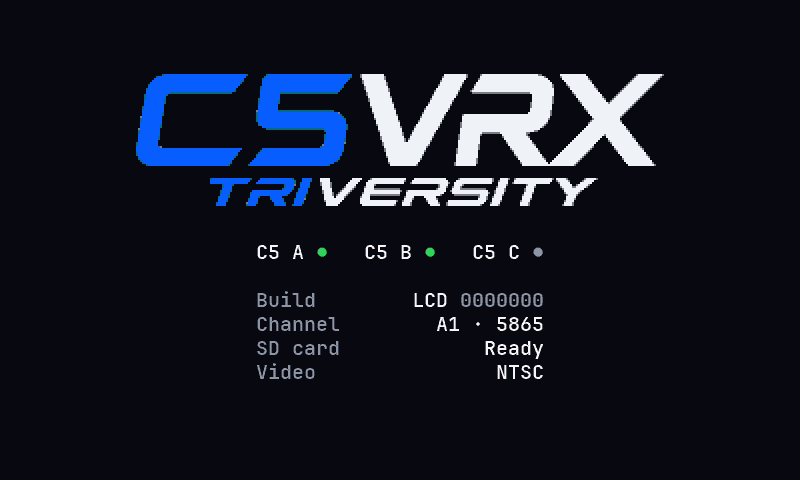
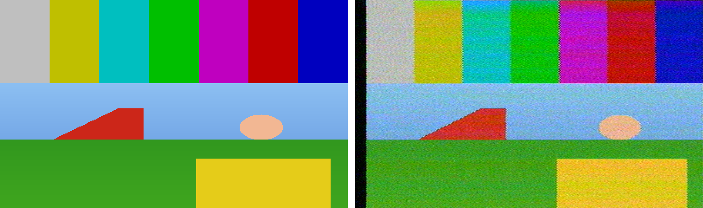
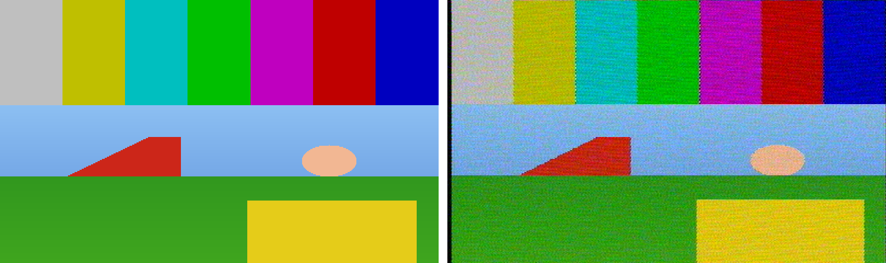
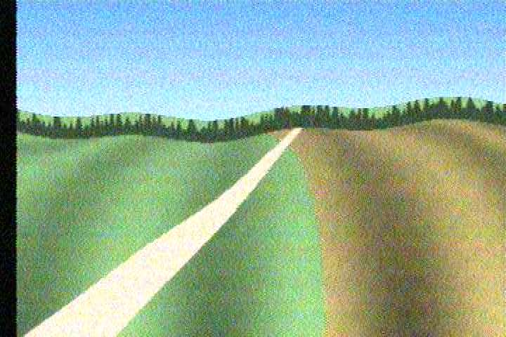
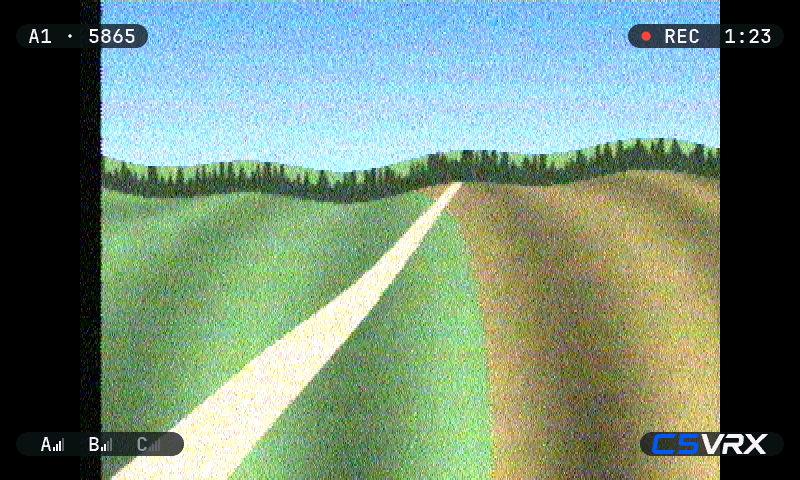

<div align="center">
  

  <p><strong>Three ESP32-C5 receivers, one FPGA, true diversity with IQ fusion</strong></p>
  <p>Three Seeed Studio XIAO ESP32-C5 receive the same 5.8 GHz FPV channel on their own antennas; a Sipeed Tang Nano 20K fuses their IQ before demodulation and drives an 800x480 screen in colour, with a menu and a DVR.</p>

  <p>
    <a href="https://twotoz.github.io/triversity/"></a>
    <a href="https://twotoz.github.io/C5VRX/"></a>
    <a href="https://discord.gg/3YNgJRHmzD"></a>
    
    
    
    
    
  </p>

  <p>
    
    
  </p>
</div>

---

Each C5 streams raw IQ (3-bit I + 3-bit Q, 40 MS/s) plus its sample clock to
the FPGA. The FPGA aligns the three streams, combines them **before** FM
demodulation (maximal-ratio combining with a phase tracker per branch),
demodulates once and shows the picture with an on-screen menu.

- Three receivers, three antennas, one picture: a fading antenna counts less,
  a dead one drops out, and together they push the FM threshold down.
- Mode Single, Diversity (two C5s fused) or Triversity (three fused).
- Gain, DC and AFC stay local on each C5; the FPGA sets the channel and the
  settings over one shared wire.
- All three C5s run the same firmware; the wiring decides which is A, B or C.
- Three buttons on C5 A (Up, Select, Down) drive the menu.
- Colour (NTSC and PAL), 60 / 50 pictures a second on the screen.
- HQ DVR: every field as a 720-wide colour JPEG on the Tang's TF card, 60 / 50
  fields a second, next to Triversity and the full menu (fields buffered in
  the Tang's SDRAM).

> [!NOTE]
> **Triversity is an official C5VRX version**, made by Twotoz and the C5VRX
> contributors as part of the C5VRX project.

> [!NOTE]
> **Status:** C5 firmware and FPGA bitstream build; models, RTL, the video
> path and the OSD are verified in simulation. Nothing has run on a board yet.

## Flashing

[Web flasher](https://twotoz.github.io/triversity/): the C5 firmware onto
each XIAO over USB (Chrome or Edge), and the Tang Nano 20K bitstream as a
download with its `openFPGALoader` command (browsers cannot reach the Tang's
USB debugger). Every push to `main` that changes the firmware or the FPGA
design publishes a release (`release.yml`); `pages.yml` mirrors the newest
releases into the flasher.

Three bitstreams with the same receiver; the LCD and HDMI share the Tang's
pins, so flash the one for your screen:

| | `triversity.fs` | `triversity_hdmi.fs` | `triversity_hdmi90.fs` |
|---|:---:|:---:|:---:|
| Output | 800x480 RGB LCD | HDMI 720x480p60 / 720x576p50 | HDMI 720x480 @ 89.9 Hz / 720x576 @ 90 Hz |
| Picture locked to the camera, line by line (no frame buffer) | ✅ | ✅ | ❌ field buffer in the SDRAM |
| Extra delay | none | none | up to a field + a frame |
| Three C5s fused (Single / Diversity / Triversity) | ✅ | ✅ | ✅ |
| Colour (NTSC / PAL) | ✅ | ✅ | ✅ |
| Full menu and OSD | ✅ | ✅ | ✅ |
| Rescue, Noise filter, Keep lock, Adaptive | ✅ | ✅ | ✅ |
| Aspect (4:3 / 16:9 / Stretch / Auto) | ✅ | ❌ the screen scales | ❌ the screen scales |
| HQ DVR (colour JPEG of every field to the TF card) | ✅ | ✅ | ❌ |
| Link log (with the DVR) | ✅ | ✅ | ❌ |
| LUT4 / BSRAM used | 83 % / 45 of 46 | 84 % / 42 of 46 | 66 % / 31 of 46 |

The HQ DVR buffers the fields in the Tang's built-in 8 MB SDRAM (block order,
up to four fields), so recording never takes block RAM or time from the
picture; the 90 Hz build uses that SDRAM for its field buffer instead. Timing
is met in all three (`fpga/build.sh` tries placements, seed and density, until
one routes: at 85 % not every one does). `PLACEMENT=3:0.8 fpga/build.sh` builds
exactly one placement; every build writes `fpga/build/placement.txt` (commit,
placement, Yosys and nextpnr versions). CI and releases use the same pinned OSS
CAD Suite (2026-11-24, `.github/actions/build-fpga`), so a placement that routed
locally can be given to the Release (or FPGA) workflow's manual run and gives the
same bitstream; each release carries a `.placement.txt` per bitstream.

## Experimental hardware — flight safety warning

> [!WARNING]
> **Triversity is an experimental FPV receiver that has not flown yet. Bugs,
> signal loss or incompatibility with your VTX can cause sudden loss of video.
> Loss of FPV video can lead to a crash, property damage or serious injury.**
> Do not rely on it as your only means of keeping safe control of an aircraft.

- Test every firmware, bitstream and settings combination on the ground
  first, propellers removed.
- Scanning, channel changes, calibration and mode changes can interrupt the
  picture: do them on the ground.
- Provided under [GPL-3.0-only](LICENSE), including its warranty and
  liability provisions in sections 15–17.

## Menu

Rendered by the FPGA RTL in simulation (`fpga/sim/run_osd_tb.py`), pixel for
pixel what the LCD shows. The picture behind it went through the receive chain
too (three C5s at 13 dB C/N, IQ fusion, discriminator, sync): the grain is the
receiver's own.

| | |
|---|---|
|  |  |
|  |  |
|  | |

| | live view | menu | editing a value |
|---|---|---|---|
| Up / Down | channel | move | change (live) |
| Select | open menu | open / toggle / edit | done |
| Hold Select | | close | close |

The main menu ends with **Exit**. The Tang's own buttons work too: S1 is Down,
S2 Select (held: close), so with Down wrapping round and Exit the whole menu
works without the buttons on C5 A (S1 is no longer a reset).

**Start-up screen** (the menu builds): the Triversity logo, revealed from the
top, and below it C5 A / B / C, the build and its git commit, the channel, the
SD card and the video. A C5's dot is green once it is heard, red when it
reports its DC fault or is still silent after 1 s. The screen stays at least
1 s, then goes when there is video or on Select, after 3 s at the latest (also
with no C5 at all: then the picture is black and the menu still works). Leaving
it, the mode drops to Diversity (A and B work) or Single when C5s are missing.



- **Channel**: all 48 (R, A, B, E, F, L); the pill lights up after a change.
- **Mode**: how many C5s are fused: Single (A), Diversity (A + B, IQ fusion)
  or Triversity (A + B + C, IQ fusion). C5s left out keep running and show
  Idle; the live view greys them out.
- **Scan**: every channel 0.5 s, picks the one with the best sync.
- **Record**: Off -> On (video + link log) -> Log (link log only) -> Off;
  No card, Ready, the recording time, Log, Card err. The link log: every
  sixth field (0.1 s) a record with per C5 the C/N, signal and AFC / video
  flags, the combining weights, sync lock and quality, channel, mode, the Signal switches, whether Rescue
  is in use, the Noise filter's level and the DVR's field number (so it lines up with the video).
  `tools/trilog.py` turns it into CSV and a plot.
- **Receivers**: per C5 signal, C/N, gain row and AFC state.
- **Signal** (Keep lock, Adaptive sync and Noise filter On / Off, Off after power-up; Rescue Off / Auto / On, Auto after power-up):
  - *Keep lock*: the picture and its timing stay up for ~0.5 s after the sync
    is lost (8000 lines) instead of going to the black free-run screen
    (`sim/sync_perf.py`: three 10 ms dropouts at 6 dB C/N, 525 lines on the
    free-run screen off, none on).
  - *Adaptive sync*: once the line lock is full the line phase is pulled in
    by e/8 instead of e/4: less horizontal jitter on a noisy signal; while
    locking it stays e/4 (line-start jitter at 0 dB C/N 71 -> 40 ns RMS; the
    same as off from 3 dB up).
  - *Noise filter*: adaptive noise suppression on the luma. The noise on the
    back porch (64 lines) picks a level 0..3; the luma then runs through a
    one-pole low-pass of that strength (`y += (x - y) >> level`). Level 0
    above ~13 dB C/N, so a good picture keeps all its detail; +2.4 to +3.9
    dB luma SINAD between 3 and 9 dB C/N (`sim/perf_vrx.py`).
  - *Rescue*: a second demodulator for very weak signals, a phase-locked
    loop on the combined angle (FM threshold extension: it rides through the
    noise "clicks" that break up the normal discriminator's picture). It costs
    some sharpness and colour, so Auto only uses it while the normal
    discriminator clicks a lot (from 100 clicks per 13 ms, back below 25) and
    hands back on a good signal. `sim/perf_rescue.py`, picture lock with the
    goggle model, colour scene:

    | | Off | Auto |
    |---|---|---|
    | 1 C5, -2 dB C/N | 0.04 | 0.93 |
    | 1 C5, 0 dB | 0.31 | 1.00 |
    | 1 C5, 0 dB, fading 300 Hz | 0.46 | 0.76 |
    | 3 C5s, -4 dB | 0.38 | 1.00 |
    | 3 C5s, -2 dB, fading 300 Hz | 0.72 | 0.97 |

    About +4..5 dB SINAD while it is in use (1 C5 to 9 dB C/N, three to
    ~5 dB); above that Auto stays on the normal discriminator. On shows the
    PLL always (softer picture on a good signal). The link log records when
    it is in use.
- **Settings**: gain model (Level, Keel, RSSI), AFC, aspect, logo,
  brightness, calibrate (filter and DC on every C5). The 90 Hz HDMI build has
  **90 Hz** in place of brightness: Free (the output runs on the crystal, the
  newest complete field; the default), Camera (the frames are locked to the
  fields, 3 to 2 NTSC / 9 to 5 PAL, and a field is shown while it is still
  coming in once the display cannot overtake it: ~12 ms less delay in NTSC),
  Smooth (Camera, and each frame is shifted to where the scene is at that
  moment: whole-picture motion per field, horizontal in four bands and
  vertical, `rtl/video/motion.v`; a 4 px a field pan moves 2 / 3 / 3 px a
  frame instead of 0 / 4 / 4). `sim/run_hdmi90_tb.py --mode=1 / 2 --motion`.
- **Aspect**: 4:3 (the picture in the middle 640 columns, black bars), 16:9
  (full width, for 16:9 cameras), Stretch (a 4:3 picture over the full width:
  true geometry in the middle, the edges stretched), Auto (16:9 when the camera
  says so with CGMS-A on NTSC or WSS on PAL, else 4:3; detection checked in
  simulation, not yet with a real FPV camera).
- **Logo**: the small C5VRX logo in the live view, on or off.

The OSD is made for the 5" 800x480 screen: 12 x 24 pixel characters, a
monospace font that stays sharp at that size, no thin lines.

## Colour

The FPGA decodes the colour itself, from the same demodulated signal: burst
PLL, U / V demodulation, saturation from the burst, luma with the chroma
subtracted. Both pictures below are the source next to what the RTL
(`vid_sync.v` with `chroma.v`) makes of it after three C5s at 20 dB C/N.

| NTSC | PAL |
|---|---|
|  |  |

FM noise rises with frequency and the colour sits at 3.6 / 4.4 MHz, so the
colour gets more noise than the brightness. Two measures halve its noise power
(measured on colour bars at 13 and 20 dB C/N): a narrower chroma filter (two
subcarrier periods) and U / V averaged with the line above (PAL's delay line,
used on NTSC too). Colour turns off when the burst is too weak.

## Why IQ fusion

Classic true diversity switches between receivers after demodulation, and AV
mixing adds demodulated video: both help against fades but cannot move the FM
threshold, so if every receiver is below it, the result is noise. IQ fusion
adds the signals first, so one demodulator sees a better signal.

Host simulation against one C5VRX receiver (production D32-R2 decoder), same
channel model (NTSC, independent noise, Rayleigh fading per antenna):

| C/N gain vs one C5VRX | static | fading 100 Hz | fading 300 Hz |
|---|---|---|---|
| 3 C5s, picture lock 50 % | +3.2 dB | +3.8 dB | +3.6 dB |
| 3 C5s, picture lock 90 % | +3.9 dB | +8.3 dB | +5.7 dB |
| 2 C5s, lock 50 % | +1.6 dB | +2.5 dB | +2.5 dB |
| 2 C5s, lock 90 % | +2.1 dB | +4.4 dB | +2.0 dB |

Picture noise at equal C/N is 5-6 dB lower with three C5s. Requires the
click-suppressed discriminator (D32-R2's 50 ns rule on the combined angle);
the plain per-sample discriminator loses 3-5 dB. Simulation only: no board,
goggle or range result.

## Wiring

FPGA board: [Sipeed Tang Nano 20K](https://link.amazon/B0cnSBh4M) (affiliate link).


| XIAO pad | signal | C5 A | C5 B | C5 C |
|---|---|---|---|---|
| D0 | clock (RX40) | 76 | 72 | 73 |
| D1 | Q sign | 80 | 71 | 74 |
| D2 | Q bit 2 | 56 | 53 | 75 |
| D3 | I sign | 54 | 52 | 85 |
| D4 | I bit 2 | 55 | 18 | 15 |
| D5 | I bit 1 | 86 | 19 | 16 |
| D6 | Q bit 1 | 79 | 20 | 17 |
| D10 | channel link (UART RX) | 51 | 51 | 51 |
| MTDO, MTCK (back) | Q0, I0, internal only, not connected | - | - | - |

Buttons, C5 A only, on its free side pads (each to GND, internal pull-up):

| pad | GPIO | button |
|---|---|---|
| D9 | 9 | Up |
| D8 | 8 | Select |
| D7 | 12 | Down |

The XIAO's own B (BOOT) button still flashes as usual and can act as Select.
On the Tang: S1 Down, S2 Select (see Menu).
C5 A forwards a press in-band in its IQ stream; the FPGA drops C5 A from the
combination for those few microseconds (B and C cover it) and handles the menu.

Numbers are Tang Nano 20K pins; the 40-pin LCD keeps its own pins.

- C5 C sits on the underside of the carrier, so its row runs D0..D6 like A and B.
- Pin 51 is the onboard amplifier enable: the channel link is sent inverted
  (idle low), which keeps the amplifier off.
- 5V and GND: one input (+ / -), GND from the Tang pin next to 5V to every C5.
- 33-47 ohm series resistor on every IQ line, close to the XIAO.
- Avoid GPIO11 (D6) for timing-critical bits; only Q bit 1 uses it.

## Repository

```
c5/            C5 firmware (ESP-IDF), one image for C5 A, B and C
  main/        receiver, gain, calibration, AFC, FPGA link and markers
  test/        host tests
fpga/          FPGA design for the Tang Nano 20K
  rtl/rx/      capture alignment, markers, IQ fusion, discriminator
  rtl/video/   sync, line buffer, LCD output
  rtl/ui/      menu and OSD (glyphs and pages generated)
  rtl/io/      link to the C5s, DVR
  boards/      pin constraints
  gen/         generators: OSD look (gen_osd.py), combiner tables
  model/       Python models of the combiner
  sim/         testbenches and their runners
  build.sh     bitstream (open-source Gowin flow)
tools/         PC tools: DVR file and video, the Pages site
web/           web flasher
docs/          images
```

Two firmware chains, two CI workflows: `c5.yml` (host tests, ESP-IDF build)
and `fpga.yml` (all testbenches, bitstream); `release.yml` publishes both,
`pages.yml` deploys the web flasher.

## C5 firmware

`c5/` is a stripped C5VRX-5 receiver for this job: the same image runs on
all three C5s (ESP-IDF v6.0.2, `idf.py set-target esp32c5 build`; CI builds it
and runs the host tests in `c5/test/run_tests.sh`).

Kept from C5VRX, unchanged in behaviour: RF front end and PHY baseline (11p
helper, digital filter mode 12), Direct Gain with LEVEL AGC, LEVEL TOP and
STRONG LANE, C/N-AUTO noise maps, DC tables, base map and live DC servo, LOW
DC, sampling-phase alignment at boot, manual filter/DC calibration (F, B),
AFC with PAL/NTSC detection, VTX profiles, flight log and field diagnostics.

Removed: the BitScrambler decoders and their tables, PARLIO TX and the DAC,
output level and AUTO OUTPUT, the on-screen menu, splash and BOOT-button UI,
the channel scanner and the bench labs. The FPGA demodulates, draws the menu
and scans.

New:

- PARLIO RX clock exported on D0; IQ pads as in the wiring table.
- FPGA link on D10 (`c5/main/fpga_link.h`): channel, gain model, AFC and
  calibration requests from the FPGA's menu.
- In-band markers on the IQ pads: button presses and once a second the gain
  row, C/N, flags (AFC lock, video, busy, DC fault, lane, PAL), channel and
  signal strength, for the FPGA's OSD.

- IQ LED: the Q sign bit is also copied onto the XIAO's own user LED. Half lit =
  IQ flowing; fully on or off = IQ stopped. Console `L` turns it off (80 MHz
  edges next to the antenna: switch it off for a noise comparison).

USB console: `T` status, `h` keys, `L` IQ LED, `` ` `` reboot to download.

## FPGA

`fpga/build.sh` builds the bitstream (Yosys, nextpnr-himbaechel, Apicula);
`openFPGALoader -b tangnano20k -f fpga/build/triversity.fs` flashes it.

- IQ path on C5 A's 40 MHz clock: capture of the three C5s, alignment of B and
  C to A, marker detection (a C5 sending a marker is left out for those
  samples), pre-detection MRC and the click-suppressed 50 ns discriminator
  (`rtl/rx/mrc3_core.v`, bit-exact with `model/mrc3_model.py`).
- Video: sync slicer on a low-passed luma (locks down to 0 dB C/N; on the
  plain luma it needed 14 dB: FM clicks cut the sync pulses and pulled the
  pre-lock slicer below the sync tip) with H/V flywheel, PAL/NTSC detection, automatic black
  and white levels, colour (`rtl/video/chroma.v`, bit-exact with
  `model/chroma_model.py`), 800 RGB565 pixels a line into a line buffer.
- LCD, menu and link on a 33.75 MHz PLL clock from the Tang's crystal: every
  video line shown twice (480 lines, genlocked, no frame buffer). OSD: 66 x 20
  cells of 12 x 24 pixels, anti-aliased glyphs, panels that dim the video.
- HQ DVR (in the default build): every field as a
  baseline JPEG, 720x240 (NTSC) or 720x288 (PAL), colour 4:2:0, 59.94 / 50
  fields a second; the PC weaves pairs into 720x480 / 720x576 frames.
  `rtl/io/jpeg_enc.v` (DCT, quantiser, Huffman coder; byte for byte the same
  as `model/jpeg_model.py`) gets 16-line strips from `rtl/io/dvr_hq.v`;
  `rtl/io/sd_ring.v` writes the records to `TRIDVR.BIN` on the TF card
  (SPI mode at 20 MHz; found by its header sector, written as a ring: the
  oldest part is overwritten). The quality follows the field sizes (8 steps,
  JPEG quality 30 to 90) to about 1.5 MB/s, 88 MB a minute, what SPI mode
  keeps up with; a field that would not fit (slow card) is dropped whole.
  The fields wait in the SDRAM (`rtl/io/sdram.v`, the GW2AR's 2M x 32 part)
  in 8 x 8 block order, so the encoder reads a block as one burst and may
  lag up to three fields behind the camera.
- Grey DVR (`rtl/io/dvr.v`, `DVR=1 fpga/build.sh`, kept for reference: with the
  colour decoder and the menu it does not place): 400x240 in 16 grey levels at 30 fps.
- Fit (LCD): 84 % LUT4, 45 of 46 BSRAM, 21 MULT18 + 35 MULT9; 62 MHz on the
  40 MHz IQ clock, 48 MHz on the LCD clock (33.75 needed). HDMI: 85 % LUT4,
  59 MHz IQ clock, 48 MHz pixel clock (27 needed); at 85 % only some seeds
  place (`build.sh` tries a list in turn, `fpga/tools/fit.py` searches in parallel). The DSP blocks are kept at or below
  38.5 MULT18 equivalents (MULT18 + MULT9 / 2): above that nextpnr's placer
  does not finish. `fpga/tools/fit.py` shows the resources per module.

HQ DVR on the PC:

```
fpga/build.sh                                    # the bitstream (or triversity.fs from a release)
python tools/make_dvr_file.py /media/TF          # once, on a freshly formatted FAT32 card
python tools/hqdvr_to_mp4.py /media/TF/TRIDVR.BIN rec.mp4          # 720x480 at 29.97 fps (PAL 720x576, 25)
python tools/hqdvr_to_mp4.py /media/TF/TRIDVR.BIN rec.mp4 --bob    # every field, 59.94 / 50 fps
python tools/trilog.py /media/TF/TRIDVR.BIN log.csv --plot log.png # the link log (Record On or Log)
```

A recorded field as `hqdvr_to_mp4.py --bob` shows it: the JPEG exactly as the
RTL wrote it to the simulated card (the colour test scene through the receive
chain at 13 dB C/N, quality 60), line doubled to 720x480:



The HQ build's screen while recording:



HDMI (`HDMI=1 fpga/build.sh` -> `triversity_hdmi.fs`): the LCD's pins 33-40
carry the TMDS pairs (emulated LVDS, LVCMOS33D), so one bitstream drives one
of the two. 720x480p59.94 (NTSC) or 720x576p50 (PAL, all 288 lines a field)
at 27 MHz, exactly twice the analog line rate: the same genlocked line
doubling as the LCD, no frame buffer. The display samples 720 pixels a line,
the DVR records the same pixels; the OSD is the LCD's grid cropped to
columns 3..62 (`run_osd_tb.py --hdmi` checks it pixel for pixel, the TMDS
encoder `run_tmds_tb.py`).

Buffered LCD (`NODVR=1 LCDBUF=1 fpga/build.sh`, released as `triversity_lcd_live.fs`;
without the HQ DVR): the panel runs on fixed timing from the crystal (every line
1072 / 1080 clocks) and reads each source line from the SDRAM field buffer
(`fbuf.v`, 400 words a line), one frame a field, about 3 ms behind the camera
(`LAG_W` in `lcd_out.v`). The panel never sees a line or frame shaped by the
source, so a lock, a dropout or a field-length change cannot shift the picture
or the OSD; while the frame lock settles it shows the last complete field.
`run_lcdbuf_tb.py` checks it from the source to the panel.

HDMI at 90 Hz (`HDMI90=1 fpga/build.sh` -> `triversity_hdmi90.fs`, for screens
that need 90 Hz; without the HQ DVR): the output free-runs from the crystal at
48.6 MHz, 720x480 at 89.88 Hz (NTSC, 1030 x 525) or 720x576 at 90.00 Hz (PAL,
864 x 625), and shows the newest complete field from a three-slot field buffer
in the SDRAM (`rtl/video/fbuf.v`), each line twice. The fields are shown once
or twice in turn (59.94 / 50 Hz into 90 Hz), never two in one frame; the
buffer adds up to a field and a frame of delay. `run_hdmi90_tb.py [--pal]`
checks it from the source to the pixels.

Simulation (`fpga/sim/`): `run_tb3.py` (combiner, bit-exact), `run_marker_tb.py`,
`run_link_tx_tb.py`, `run_chroma_tb.py` (colour, bit-exact),
`run_dvr_tb.py` (SD card model with a FAT32 image, fast and slow card), `run_osd_tb.py` (OSD pixel for pixel against `gen/gen_osd.py`; `--hq` the HQ build's screen),
`run_align_tb.py` (the shared B/C alignment against two separate engines on FM-modulated video),
`run_jpeg_tb.py` (JPEG encoder byte for byte against `model/jpeg_model.py`; NTSC, PAL, stalled output),
`run_dvr_hq_tb.py` (HQ DVR to the SD card model, every record byte-exact, read back with `tools/hqdvr_to_mp4.py`; `--log` with the link log, read back with `tools/trilog.py`),
`run_ans_tb.py` (Noise filter, bit-exact), `perf_vrx.py` (picture performance: one C5 against three per scenario, the Noise filter), `perf_rescue.py` (Rescue Off / Auto / On; `run_tb3.py` checks the PLL bit-exact, on and switching),
`run_aspect_tb.py` (CGMS-A / WSS through the receive chain),
`run_hdmi90_tb.py` (the 90 Hz HDMI output: field buffer, SDRAM and output, every pixel, NTSC and PAL),
`run_video_tb.py` (test picture through the whole chain; needs C5VRX's
`research/` next to this repo or in `$C5VRX_RESEARCH`).


## Open questions for the first prototype

1. IQ pad timing at the FPGA (the modem bus runs at ~80 MS/s, sampled at 40).
2. Frequency offset between the three C5s before AFC lock.
3. Self-noise: C5 noise floor with the FPGA and LCD on and off.
4. C5 boot with the FPGA powered (D2/D3 are strapping pins).

## Credits

Triversity is part of [C5VRX](https://github.com/Twotoz/C5VRX) by Twotoz and
the C5VRX contributors. The combiner (Tripleversity in C5VRX), its models and
the receiver research come from C5VRX (`hardware_experiments/tang9k_dual`,
`hardware_experiments/tripleversity` and the D32-R2 decoder). The C5 firmware
in `c5/` is C5VRX-5 `main/`, `CMakeLists.txt`, `sdkconfig.defaults` and
`partitions.csv` at commit `f3d172f` (C5VRX main `8b60fef` plus the
`claude/tang-9k-c5-5bit-iq-hmes6d` branch), stripped for this job, with its
host tests from C5VRX `test/`; each changed file's header says what changed.
Visit the [C5VRX website](https://twotoz.github.io/C5VRX/) for the project and
its Discord invite. GPL-3.0-only (`LICENSE`).

OSD font: JetBrains Mono (SIL Open Font License 1.1). Board photos: Sipeed
(Tang Nano 20K) and Seeed Studio (XIAO ESP32-C5).
